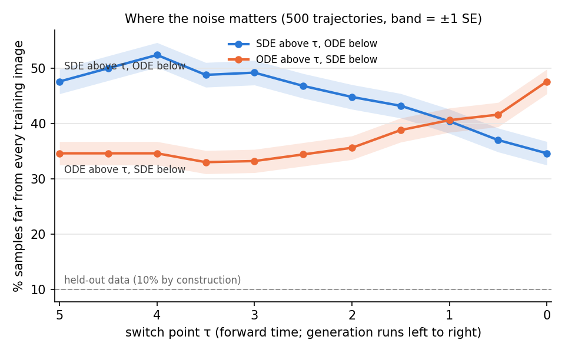

# ODE vs SDE sampling on the paper checkpoint

Why does the probability-flow ODE give worse MNIST 0/1 samples than the reverse SDE, with the same learned parameters θ(τ)? This folder holds the experiments run on 2026-11-05 to answer that (written up 2026-11-06), their Slurm job files, and copies of their result reports.

**Status (2026-11-06): closed, not pursued as a paper result.** That stochastic sampling beats the probability-flow ODE under an imperfect model is known from the diffusion literature (see [Status](#status-and-what-matters-for-the-paper)). Two side findings do matter for the paper: the 40-sample SDE draw used so far was lucky, and about 6% of SDE trajectories diverge.

## Summary

- **The SDE beats the ODE:** 35.6 ± 2.1% vs 47.6 ± 2.2% of samples are "far" from every training image (500 trajectories each; the metric is defined below).
- **The SDE's extra Langevin part has a detectable effect only for τ ≲ 2.5, down to τ = 0.** This part is a pull toward the current model distribution plus thermal noise; switching from the SDE to the ODE removes both (see Setup).
  - Running the ODE for τ 5 → 2.5 and the SDE afterwards matches the pure SDE: no detectable cost, at most about 5 points at 95% confidence.
  - The SDE only early (τ > 2.5), followed by the ODE, is no better than the pure ODE.
  - The benefit we can resolve is spread over τ ≲ 2.5: about 6 points come from τ ∈ [1, 2.5] and about 6 from τ < 1.
- **A corrector at the end does not cleanly rescue finished ODE samples.** Langevin relaxation at θ(0) barely changes them up to S = 0.1: the median nearest-image distance goes 4.89 → 4.75.
  - By S = 0.5 the median is 4.44, still well above the SDE's 3.91.
  - By then bright samples have escaped into deep wells of E_θ(0) far from the data, with pixels around ±30.
- **The 40-sample SDE draw used so far was lucky.**
  - On the paper's 40 initial states and Brownian keys, the SDE gives 22.5% far and no diverged samples.
  - Over 500 trajectories it gives about 35% far, and 5–6% of trajectories diverge.
  - The same 40 draws also flattered the comparison: there the ODE gives 55% far, so the gap looks like 32.5 points instead of 12.
- **Splitting the SDE into pieces with separate Brownian trees does not matter** (difference +1.0 ± 3.0 points), so the switching experiments are valid.

## Background

- **Causes already ruled out** by the ablation on `paper_code_v2` (commits b0af2f3 → 98793e0; [CODE_NOTES.md](../../CODE_NOTES.md) §10.1):
  - ODE integration error: tolerances tightened to 1e-7/1e-9;
  - the interpolation scheme: linear vs PCHIP;
  - kinks at the knots: solver steps forced onto them;
  - parameter jitter: Savitzky–Golay smoothing.
- **Near-data training lag: refuted** (CODE_NOTES §8.13). That check lives on `paper_code_v2` (`scripts/diagnose_near_data.py`, job 4181431) and was not moved here.
  - The step-budget lag does not occur: per-pixel blank stiffness is 1.00–1.03× optimal, and the global scale ratio R is 0.98–1.01.
  - The fits are not exact, though: near τ = 0 the uniform background mode is only 0.57–0.82× as stiff as optimal.
- **Leading candidate going in** (CODE_NOTES §10.1, candidate 1): the SDE is the ODE plus Langevin dynamics at the current slice, and that extra term corrects errors; the ODE has no corrector.

## Setup common to all experiments

- **Model and parameters.** The paper run's `params_history.npy`: 100 slices on τ ∈ [0, 5], row 99 = τ 0.
  - Raw parameters, linear interpolation between knots, solver steps forced at the knots (`step_ts`).
  - This is the ablation variant raw / linear / step-knots in `interpolation_ablation_v1/`. Its 40 saved ODE and SDE samples are the references.
- **Samplers** (CODE_NOTES §6).
  - Reverse time t ∈ [0, 5]; forward time τ = 5 − t; temperature T = 0.02.
  - Reverse SDE: physical parameters θ_rev = 2θ(τ) − θ_lin, with thermal noise √(2T) dW.
  - PF-ODE: θ_pf = θ(τ) − θ_lin, with no noise.
  - SDE solver: SRA1 (rtol 1e-4, atol 1e-6, Brownian tolerance 1e-12). ODE solver: Tsit5 (rtol 1e-7, atol 1e-9).
- **What switching samplers changes.**
  - Because the energy is linear in θ, the SDE's drift is the ODE's drift plus −∇E(x; θ(τ)): overdamped Langevin dynamics at temperature T targeting p̂_τ ∝ e^{−E(x;θ(τ))/T}.
  - Switching from the SDE to the ODE therefore removes this Langevin part, pull and noise together, not just the noise.
  - A noise-free version of the SDE protocol itself (θ_rev at T = 0) was never run.
- **Initial states** x ~ √T·N(0, I).
  - Trajectories 0–39 are the paper's shared initial states and Brownian keys.
  - The 500-trajectory runs add 460 new draws (seed 2026).
- **Metric: "far"** (experiments 3 and 4).
  - Definition: the pixel-space distance to the nearest training image exceeds 4.84, or the sample has diverged (max|x| > 15 in normalised units).
  - 4.84 is the 90th percentile of the same distance for 200 held-out training images (seed 11), so real data are 10% far by construction.
  - Experiment 2 uses the same threshold but counts only the distance. That makes no practical difference, since diverged states are also far in pixel space.
  - Experiment 1 reports distances, not % far.
  - Also reported: out-of-range pixels (beyond the data range ± 0.2), noise on always-blank pixels and, in experiments 3 and 4, % diverged.
  - Known weaknesses: see [Caveats](#caveats).

## Experiments

### 1. Corrector test at θ(0): `relax_ode_samples.py`, job 4183295

**Question.** Are the ODE's blended digits merely unrelaxed? Would Langevin dynamics at the final parameters θ(0) un-blend them?

**Setup.**
- Langevin dynamics at θ(0) and T = 0.02 for S = 0.5 time units.
- Applied to the 40 saved ODE samples (#30, already diverged, excluded) and, as a control, to the 40 saved SDE samples.
- Reference for this experiment: its own 200 held-out images (seed 7) give a median nearest-image distance of 3.37 (p90 5.12) and a median E/T of +2,539.

| | S = 0 | 0.02 | 0.1 | 0.5 |
|---|---|---|---|---|
| ODE: nearest-image distance (median) | 4.89 | 4.87 | 4.75 | 4.44 |
| ODE: out-of-range pixels | 4.6% | 4.5% | 4.2% | 11.0% (max \|x\| 30) |
| ODE: E/T (median) | +56 | −204 | −608 | −1,973 |
| SDE: nearest-image distance (median) | 3.91 | 3.91 | 3.91 | 3.92 |
| SDE: out-of-range pixels | 2.2% | 2.2% | 4.6% | 7.7% (max \|x\| 31) |
| SDE: E/T (median) | −1,792 | −1,808 | −1,952 | −2,490 |

**Result: no clean rescue.**
- **Short relaxation leaves the blends in place.** Up to S = 0.1 the ODE images are visually unchanged, although their energy falls fast.
- **Longer relaxation moves them only partway, and at a cost.**
  - By S = 0.5 the median distance has fallen to 4.44, about half of the way to the SDE's 3.91, while the SDE control stays flat.
  - Meanwhile 11% of pixels go out of range.
  - % far after relaxation was not measured.
- **E_θ(0) has deep wells far from the data.**
  - By S = 0.5, bright samples of both samplers escape to saturated states with pixels around ±30: 3 of the 10 ODE samples shown, 1 of the 10 SDE.
  - E/T of the SDE samples keeps falling (−1,792 → −2,490), while real data sit at about +2,540.
  - So the equilibrium distribution p_θ(0) is not a good model of the data. The samplers produce digits because they stop before reaching it.

### 2. Hybrid samplers, 40 trajectories: `ode_noise_window.py`, job 4183406 (superseded by 3)

**Question.** Where along the path does it matter whether the SDE or the ODE runs?

**Setup.**
- Hybrids on the paper's 40 trajectories.
- SDE>ODE@τ: SDE above τ, ODE below. ODE>SDE@τ: the reverse.
- burst@τ: ODE throughout, plus a 0.5-unit Langevin burst at a frozen θ(τ).
- The plain ODE re-run reproduces the saved ODE samples to 3.9e-12.

| sampler | % far | out-of-range pixels |
|---|---|---|
| ODE | 55 | 7.0% |
| SDE (saved) | 22.5 | 2.2% |
| SDE>ODE@4 / @3 / @2 / @1 | 52.5 / 55 / 45 / 25 | 6.3 / 5.7 / 3.3 / 2.7% |
| ODE>SDE@4 / @2 / @1 | 20 / 35 / 42.5 | 6.9 / 7.6 / 12.6% |
| burst@4.5 / 3.5 / 2.5 / 1.5 / 0.5 | 82.5 / 55 / 47.5 / 47.5 / 42.5 | 25 / 4.5 / 9.4 / 6.4 / 8.3% |

- **At the time this read as "the noise matters for τ ≈ 1–4". Experiment 3 overturns that reading.**
  - ODE>SDE@4 = 20% and SDE>ODE@1 = 25% looked like SDE quality.
  - They lie 14.6 and 15.4 points below their 500-trajectory values, about 2 SE at n = 40.
- **What survives:** the burst at τ = 4.5 is destructive (25% of pixels out of range), so p̂_4.5 also has far-off wells.
- **Open:** the late bursts (τ = 1.5, 0.5) were as good as the late SDE within the error. Whether a short frozen-θ burst inside τ ≲ 2.5 can replace the SDE was never tested at 500 trajectories.
- **Noise note.**
  - `solve_SDE` builds its `VirtualBrownianTree` on the segment's own [t0, t1]. With the paper's keys, each hybrid's SDE segment therefore draws a time- and amplitude-rescaled copy of the paper's tree, not the paper's path itself.
  - The hybrids are valid samplers, but their noise is neither the paper's nor independent of it.
  - That may be why their numbers resemble the lucky saved SDE draw. This was not tested.
  - Experiment 3 avoids the issue with independent keys per interval.

### 3. Switch points every 0.5 in τ, 500 trajectories: `ode_noise_window_fine.py`, job 4183779

**Setup.**
- Reverse time is cut into 10 intervals of 0.5. Each sampler is a mode string with one letter per interval, starting at τ = 5: O = ODE, S = SDE.
- SDE[hi,lo] means the SDE runs only while τ ∈ [lo, hi].
- **Noise.** Interval i of trajectory j uses its own key, `fold_in(key_j, i)`. Every variant running the SDE on a given interval sees the same noise there, so the differences Δ are paired.
- **Shared computation.** Variants with a common prefix share it (a trie over the mode strings), and progress is checkpointed after each interval.
- **Diverged states** (max|x| > 15 at an interval boundary) are frozen and counted as far.
- **Sanity check:** the split ODE reproduces the saved ODE on trajectories 0–39 (median max|diff| 2.5e-8, max 2.1e-5).
- **Runs.** Smoke run with 44 trajectories: job 4183778. The full run took 6.4 h on one L40, of which the last interval (τ 0.5 → 0) took 5.5 h.

**Results.** In the table, % far has a binomial SE of 2.1–2.2. Δ is the paired difference to the pure SDE, given with its SE.

| sampler | mode | % far | Δ vs SDE | % diverged |
|---|---|---|---|---|
| ODE | OOOOOOOOOO | 47.6 | +13.0 ± 2.6 | 1.6 |
| SDE | SSSSSSSSSS | 34.6 | — | 5.2 |
| SDE>ODE@4.5 | SOOOOOOOOO | 50.0 | +15.4 ± 2.5 | 2.8 |
| SDE>ODE@4 | SSOOOOOOOO | 52.4 | +17.8 ± 2.2 | 2.2 |
| SDE>ODE@3.5 | SSSOOOOOOO | 48.8 | +14.2 ± 2.1 | 2.0 |
| SDE>ODE@3 | SSSSOOOOOO | 49.2 | +14.6 ± 1.8 | 1.6 |
| SDE>ODE@2.5 | SSSSSOOOOO | 46.8 | +12.2 ± 1.7 | 1.4 |
| SDE>ODE@2 | SSSSSSOOOO | 44.8 | +10.2 ± 1.6 | 1.4 |
| SDE>ODE@1.5 | SSSSSSSOOO | 43.2 | +8.6 ± 1.4 | 1.8 |
| SDE>ODE@1 | SSSSSSSSOO | 40.4 | +5.8 ± 1.2 | 2.2 |
| SDE>ODE@0.5 | SSSSSSSSSO | 37.0 | +2.4 ± 0.9 | 3.2 |
| ODE>SDE@4.5 | OSSSSSSSSS | 34.6 | 0.0 ± 1.9 | 6.0 |
| ODE>SDE@4 | OOSSSSSSSS | 34.6 | 0.0 ± 2.2 | 5.8 |
| ODE>SDE@3.5 | OOOSSSSSSS | 33.0 | −1.6 ± 2.4 | 5.6 |
| ODE>SDE@3 | OOOOSSSSSS | 33.2 | −1.4 ± 2.5 | 4.2 |
| ODE>SDE@2.5 | OOOOOSSSSS | 34.4 | −0.2 ± 2.5 | 4.6 |
| ODE>SDE@2 | OOOOOOSSSS | 35.6 | +1.0 ± 2.6 | 4.6 |
| ODE>SDE@1.5 | OOOOOOOSSS | 38.8 | +4.2 ± 2.6 | 6.2 |
| ODE>SDE@1 | OOOOOOOOSS | 40.6 | +6.0 ± 2.6 | 5.4 |
| ODE>SDE@0.5 | OOOOOOOOOS | 41.6 | +7.0 ± 2.6 | 5.4 |
| SDE[4,1] | OOSSSSSSOO | 39.2 | +4.6 ± 2.2 | 2.6 |
| SDE[4,2] | OOSSSSOOOO | 43.2 | +8.6 ± 2.3 | 2.4 |
| SDE[3,1] | OOOOSSSSOO | 38.4 | +3.8 ± 2.6 | 2.2 |
| SDE[3.5,1.5] | OOOSSSSOOO | 42.2 | +7.6 ± 2.5 | 1.6 |

**Interpretation.**
- **For τ ≳ 2.5 the ODE has no detectable cost.**
  - ODE>SDE@τ for every τ ≥ 2 is within 1.6 points of the pure SDE.
  - For τ ≥ 2.5 the 95% upper bounds are 3–5 points, against the 13-point gap.
  - The nested ODE>SDE rows share initial states and noise, so they are not independent confirmations.
- **The SDE advantage we can resolve comes from τ ≲ 2.5, spread over that range.**
  - Removing the SDE below τ = 1 costs 5.8 points (SDE>ODE@1).
  - Removing it above τ = 1 costs 6.0 (ODE>SDE@1). Since τ > 2.5 shows no detectable contribution, that cost comes from τ ∈ [1, 2.5].
  - Together this is 11.8, against the 13.0 ± 2.6 ODE–SDE gap.
- **The SDE only early, followed by the ODE, is no better than the pure ODE.** SDE>ODE@4 is even 4.8 points worse: about 1.5 SE if treated as unpaired; the paired SE was not computed.
- **A late SDE raises divergence.** Variants ending with the SDE diverge more (4.2–6.2%) than the ODE (1.6%), consistent with the far-off wells of experiment 1.



### 4. Control: is splitting the SDE harmless? `sde_split_control.py`, job 4187940

**Question.** The smoke run's pure (split) SDE gave 43% far on its 44 trajectories (the paper's 40 plus 4 new), against 22.5% for the saved SDE samples. Was splitting the SDE the cause, or was the paper's draw lucky?

**Setup.**
- The plain reverse SDE run the paper's way: one solve and one Brownian tree on [0, 5] per trajectory.
- Same 500 initial states and base keys as experiment 3. The job also re-rendered experiment 3's curve (shown above).
- **Diverged states are not frozen here.** Each trajectory is integrated to τ = 0 and counted as diverged if max|x| > 15 at the end. The split arm (experiment 3) freezes a state once max|x| > 15 at a 0.5-interval boundary, so the two arms differ in this as well as in the Brownian splitting.

| sample set | n | % far | % diverged |
|---|---|---|---|
| SDE, one Brownian tree on [0, 5] | 500 | 35.6 ± 2.1 | 6.2 |
| SDE, split into 0.5 pieces (job 4183779) | 500 | 34.6 ± 2.1 | 5.2 |
| ODE (job 4183779) | 500 | 47.6 ± 2.2 | 1.6 |
| SDE, one tree, trajectories 0–39 (reproduces the saved samples) | 40 | 22.5 ± 6.6 | 0 |
| SDE, split, trajectories 0–39 (different noise) | 40 | 40.0 ± 7.7 | 7.5 |

**Results.**
- **Splitting does not matter:** unsplit minus split = +1.0 ± 3.0 points.
- **The paper's draw is reproduced.** With the paper's keys, trajectories 0–39 match the saved SDE samples to median max|diff| 1.4e-5 (max 8.3e-4).
- **That draw was lucky.**
  - At the population rate of about 35% far, a draw of 40 with 9 or fewer far samples has a probability of about 5–7%.
  - Zero diverged out of 40 has a probability of about 8–12% at the measured 5–6% divergence rate.
  - The two are correlated, since diverged samples count as far, so these probabilities should not be multiplied.

## Explanation

Best reading of the evidence: the location of the effect is measured; the mechanism is inferred and was not tested directly.

1. **The difference must come from model error, or from the initial states.**
   - With an exact score and initial states drawn from p_5, both samplers have the same marginals.
   - The initial states here are √T·N(0, I), while p_5 has mean e^{−5}μ, where μ is the per-pixel data mean under the global normalisation. The ODE preserves that mismatch and the SDE shrinks it.
   - Experiment 3 argues against the mismatch mattering: running the SDE only at the start, which would shrink it, does not help (SDE>ODE@4.5 and @4).
   - Model error is clearly present. θ(0) gives real data far higher energy than its own deep wells (experiment 1).
2. **The SDE has feedback; the ODE does not.**
   - The SDE is the ODE plus Langevin dynamics at the current slice (see Setup). That pull, with its noise, keeps moving the samples toward the current model distribution p̂_τ, which absorbs errors made earlier.
   - The ODE is a deterministic transport map, so errors carry through to the end. Its accuracy also depends on errors in the score's derivatives, which score matching does not control [Song 2021; Karras 2022; Lu 2022].
3. **The correction has a detectable effect only for τ ≲ 2.5.**
   - Around the 0-vs-1 decision it has no detectable effect on % far. That decision is estimated at τ ≈ 4.3–4.5, assuming a class-direction variance λ ≈ 100–160, which was not computed (CODE_NOTES §10.1, §10.3). Its effect on the 0/1 proportions was not measured.
   - τ ≲ 2.5 is roughly where pixel-level structure emerges from the noise. A pixel with amplitude a has signal e^{−τ}·a, which falls below the thermal noise √T ≈ 0.14 between τ ≈ 2 (a = 1, the RMS pixel) and τ ≈ 3 (a ≈ 3.3, full ink-vs-background contrast). This link is plausible but untested.
4. **The pull is double-edged.**
   - It can also drag trajectories into the far-off wells: 5–6% of SDE trajectories diverge, against 1.6% for the ODE.
   - Long relaxation at a frozen θ goes there (experiment 1, and the burst at τ = 4.5 in experiment 2).
   - The SDE comes out ahead because its correction is short and continual.

**Not tested:**
- Whether short frozen-θ Langevin bursts (0.1–0.25 time units) at τ = 2, 1 and 0.5 recover the SDE's quality. That would confirm the corrector mechanism directly and costs a few GPU-hours.
- Whether the SDE protocol without its noise (θ_rev at T = 0) would do better or worse than the ODE.

## Status and what matters for the paper

- **Closed as a research question.** Our results are consistent with known findings where we tested them.
  - **EDM** [Karras 2022] found that stochasticity corrects errors made by earlier sampling steps. It enables stochasticity only within a range of noise levels. Excessive stochasticity gradually loses detail, and at very low and very high noise levels it drifts toward oversaturated colours, which they suspect comes from a non-conservative learned score.
  - **Our results line up only partly:**
    - the benefit sits at τ ≲ 2.5;
    - a late SDE raises divergence into saturated wells;
    - unlike EDM's setting, removing the SDE in the last interval still costs 2.4 ± 0.9 points.
    - Our wells come from a conservative learned energy, so they are at most a phenomenological analogue of EDM's drift.
    - The error-correction mechanism itself was not tested.
  - **Restart sampling** [Xu 2023] builds on the same argument that stochasticity contracts accumulated errors.
  - With one checkpoint and a crude metric, this is not worth a standalone result.
- **For the paper.**
  1. **Don't rely on the 40-sample SDE draw.** If a figure or number comes from that draw, either use ≥ 500 samples or present it explicitly as one draw. The plain SDE on 500 trajectories takes 26 min on one L40 (experiment 4).
  2. **Don't describe θ(0)'s Boltzmann distribution as a data model.** About 6% of SDE trajectories diverge into saturated states, and E_θ(0) has deep wells far from the data. The digits come from the time-dependent protocol, not from equilibrium at θ(0).
  3. **Optional, one sentence:**
     - the probability-flow ODE gives worse samples;
     - replacing the stochastic protocol by it during the first half of generation (τ 5 → 2.5) has no detectable cost.

     The ODE is a deterministic protocol with parameters θ(τ) − θ_lin, so it lacks both the Langevin pull and the thermal noise; don't present it as "the same protocol without noise".

## Caveats

- **Scope.** One checkpoint, one dataset (MNIST 0/1), one temperature.
- **The metric is crude.** "Far" is a stand-in for "blended"; visual grids agreed with it (`noise_window_grid.png` in the output folders).
  - The threshold depends on the held-out subset: two random 200-image subsets gave p90 of 4.84 and 5.12, and medians of 2.48 and 3.37. The median is unstable; the p90 less so.
  - The metric may depend on the 0/1 mix of the samples. Class proportions were not measured.
- **Statistics.** Each 500-trajectory comparison uses one noise realisation per trajectory, and some paired SEs were not computed (noted where relevant).

## Files

| file | what | resources (as run) |
|---|---|---|
| `relax_ode_samples.py`, `run_relax_ode_neuronic.sh` | experiment 1 | 1 GPU, 24 GB, ~6 min |
| `ode_noise_window.py`, `run_ode_noise_window_neuronic.sh` | experiment 2 | 1 GPU, 64 GB, ~16 min |
| `ode_noise_window_fine.py`, `run_ode_noise_window_fine_neuronic.sh` | experiment 3 | 1 GPU, 64 GB, ~6.4 h (smoke with 44 trajectories: ~38 min) |
| `sde_split_control.py`, `run_sde_split_control_neuronic.sh` | experiment 4; reads experiment 3's output | 1 GPU, 64 GB, ~26 min |
| `noise_window_curve_4183779.png` | experiment 3's curve, as re-rendered by experiment 4 | — |
| `results/<experiment>_<job id>/` | copies of each job's `report.txt`, plus `metrics.json` for experiments 2–4 (experiment 1 writes none) | — |

- **Code is as run.** Since the runs, only these changed:
  - docstrings and comments;
  - job-file paths (for the move into this folder);
  - the direct-label placement in `ode_noise_window_fine.py`'s curve plot;
  - in `sde_split_control.py`, labels that follow `FINE_JOB` instead of a hard-coded 4183779, and the wording of one log message.
- **Full outputs** (final states, figures) are in `physical-diffusion-models/out/diagnostics/<experiment>/<job id>/`, which git ignores; they exist only on the cluster filesystem.
- **Inputs read** (all read-only): the paper run's directory under `out/2026_07_08/…/opt_per_time_plots/` (checkpoint, and the ablation's saved samples, initial states and keys) and the MNIST 0/1 data in `data/`.

## How to run

All computation goes through Slurm. Submit from this folder; the job files find the container image at `../../container/container_image.sif` and mount `physical-diffusion-models/` as `/physical-diffusion-models`.

```bash
cd physical-diffusion-models/ode_vs_sde
sbatch run_relax_ode_neuronic.sh
sbatch run_ode_noise_window_neuronic.sh
# experiment 3: smoke test first, then the full run only if the smoke test succeeds
S=$(sbatch --parsable --time=02:00:00 --job-name=noise_win_smoke --export=ALL,N_TRAJ=44,CHUNK=44 run_ode_noise_window_fine_neuronic.sh)
F=$(sbatch --parsable --dependency=afterok:$S run_ode_noise_window_fine_neuronic.sh)
# experiment 4 on that run (or --export=ALL,FINE_JOB=4183779 without the dependency to reuse the existing output)
sbatch --dependency=afterok:$F --export=ALL,FINE_JOB=$F run_sde_split_control_neuronic.sh
```

- **GPU jobs need `JAX_PLATFORMS=cuda,cpu`** (set in the job files), because the solver's progress bar calls back to the CPU.
- **Memory.** A solve over the time-dependent parameters embeds the 436 MB parameter table in its compiled program.
  - `ode_noise_window.py` therefore calls `jax.clear_caches()` after each variant, and `ode_noise_window_fine.py` after each interval's ODE and SDE group.
  - `sde_split_control.py` compiles one fixed-shape solve and reuses it for every chunk.
  - These three jobs request 64 GB of host memory.
  - `relax_ode_samples.py` uses only θ(0), does not clear the cache, and requests 24 GB.
- **Resuming experiment 3.**
  - It checkpoints after every interval (`progress.npz`).
  - To resume, export `NOISE_WINDOW_OUT=/physical-diffusion-models/out/diagnostics/ode_noise_window_fine/<job id>` (the container path) and resubmit with the same `N_TRAJ`; the script does not check that.
  - Unset `NOISE_WINDOW_OUT` afterwards, or later submissions will write into that folder.
- **Outputs** go to `physical-diffusion-models/out/diagnostics/{ode_relaxation, ode_noise_window, ode_noise_window_fine, sde_split_control}/<job id>/`.

## References

- [Song 2021] Y. Song et al. Score-Based Generative Modeling through Stochastic Differential Equations. ICLR 2021. arXiv:2011.13456.
- [Karras 2022] T. Karras et al. Elucidating the Design Space of Diffusion-Based Generative Models. NeurIPS 2022. arXiv:2206.00364.
- [Lu 2022] C. Lu et al. Maximum Likelihood Training for Score-Based Diffusion ODEs by High-Order Denoising Score Matching. ICML 2022. arXiv:2206.08265.
- [Xu 2023] Y. Xu et al. Restart Sampling for Improving Generative Processes. NeurIPS 2023. arXiv:2306.14878.
